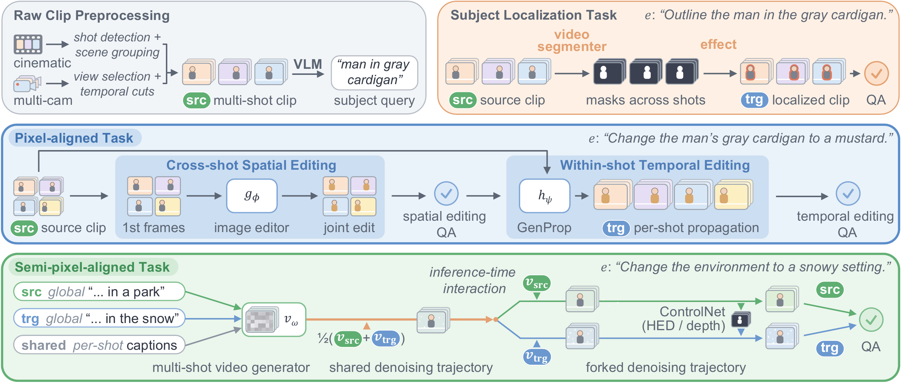
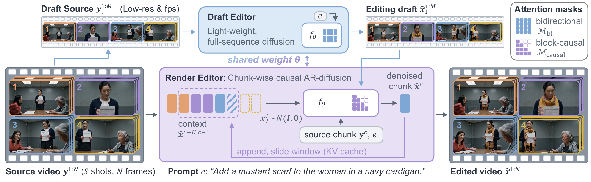
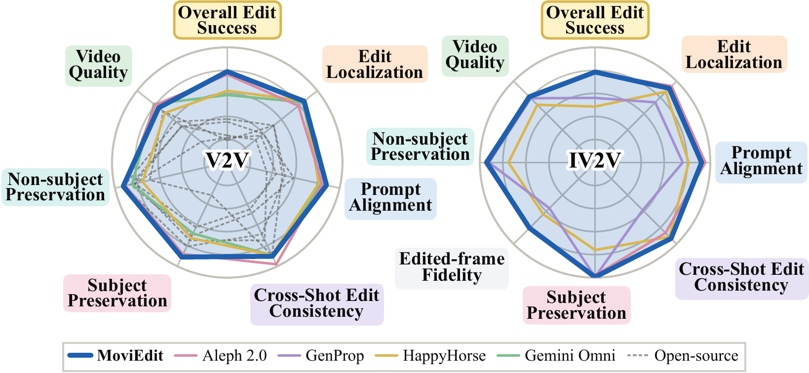

# MoviEdit: Long-form Multi-Shot Video Editing Made Easy

[Suhyeon Lee](https://hyn2028.github.io/)\*,
[Zhengang Li](https://scholar.google.com/citations?user=hH1Oun0AAAAJ&hl=en),
[Soo Ye Kim](https://sites.google.com/view/sooyekim),
[Peihao Zhu](https://zpdesu.github.io/),
[Jong Chul Ye](https://bispl-website.github.io/),
[Chun-Hao Paul Huang](https://paulchhuang.wixsite.com/chhuang), 
[Duygu Ceylan](https://www.duygu-ceylan.com/),
[Yan Kang](https://research.adobe.com/person/yan-kang/),
[Hyeonho Jeong](https://hyeonho99.github.io/)\*,†

\*Equal Contribution &nbsp;&nbsp; †Tech Lead

## Overview

Long-form multi-shot video editing requires an intended edit to remain coherent across abrupt changes in scene, viewpoint, and subject appearance, while processing a much longer visual context than conventional single-shot editors.

**MoviEdit** is an end-to-end framework for long-form multi-shot video editing that jointly addresses data, modeling, and evaluation:

- **Scalable paired data** — automatic pipelines that yield 87K paired multi-shot editing videos without manual annotation.
- **Cascaded bidirectional–autoregressive architecture** — a lightweight *Draft Editor* first resolves a globally coherent edit over a spatiotemporally compressed video, which a chunk-wise causal *Render Editor* then propagates and refines at full resolution.
- **MoviEdit-Bench** — a dedicated benchmark for evaluating cross-shot localization, consistency, preservation, and edit alignment in long-form multi-shot editing.

This repository hosts the public release of **MoviEdit-Bench**, with everything needed to run it on your own model:

- **Benchmark data**: source videos, edit instructions, edited reference frames, and evaluation metadata.
- **Evaluation code**: the metric implementations and the VLM judge, in locked environments.
- **Reference results**: MoviEdit's edited videos and the per-scenario results of the paper's evaluation run.
- **Reproducibility check**: evaluate the reference videos yourself and compare with the numbers reported in the paper.

See [`bench/README.md`](bench/README.md) to get started.

### Examples

**Text-guided editing (V2V)**

https://github.com/user-attachments/assets/be53c9ea-210e-49ef-9a2c-51af3907e993

**Edited-frame-guided editing (IV2V)**: edits given as two edited reference frames are propagated to every shot.

https://github.com/user-attachments/assets/3226130d-8a5e-4175-bb88-3c7cb63de902

**Beyond-training-horizon editing**: a 25-second video, longer than any video seen during training (15 s).

https://github.com/user-attachments/assets/ad3e45c7-fc75-4f97-834c-ddb2a4f1fa15

### Method

  

**Scalable paired-data generation.** Three annotation-free pipelines turn multi-camera footage, cinematic clips, and generated multi-shot videos into paired training data. Pixel-aligned editing splits the problem into cross-shot spatial editing and within-shot temporal propagation. Semi-pixel-aligned editing couples two generations of a multi-shot video generator.

  

**Cascaded architecture.** One shared denoiser first produces a globally consistent edit draft on a subsampled video (Draft Editor, bidirectional). It then propagates the edit chunk by chunk at full resolution (Render Editor, causal autoregressive), which prevents long-horizon appearance drift.

  

**MoviEdit-Bench.** A dedicated benchmark for long-form multi-shot editing that scores non-subject preservation, edit localization, subject preservation, cross-shot edit consistency, prompt alignment, video quality, edited-frame fidelity (IV2V), and overall edit success. On both text-guided (V2V) and edited-frame-guided (IV2V) editing, MoviEdit outperforms open-source models by a wide margin and performs on par with the strongest proprietary systems.

## MoviEdit-Bench

MoviEdit-Bench contains **64 generated multi-shot source videos** (4–6 shots, 361 frames @ 24 fps, ~15 s) and **128 editing scenarios**, covering:

- **Tasks:** text-guided editing (**V2V**) and edited-frame-guided propagation (**IV2V**, first-frame and non-first-frame references)
- **Edits:** local (add, remove, appearance change, swap) and global (environment change, stylization)
- **Metrics:** 7 dimensions — non-subject preservation, edit localization, subject preservation, cross-shot edit consistency, edit-prompt alignment, video quality, edited-frame fidelity (IV2V) — plus an aggregate **Overall Edit Success** score

See [`bench/README.md`](bench/README.md) for details.

## License

Refer to [`LICENSE.md`](LICENSE.md).
